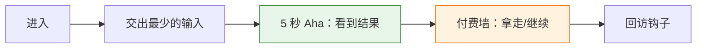

# 产品定义模板

一份产品定义一页写完，放在产品仓文档里或随 issue 交付。各节只写结论和依据，不重写选品原理。

```markdown
# 产品定义：{产品名}（{日期}）

方向与依据：{指向 direction-validator 的结论：哪种钱、五问、五特质；缺的标 待验证}

## 1. 主推点和用户
- 谁：
- 什么时刻：
- 带着什么情绪：
- 要摆脱的麻烦：
- 用户买的心理结果（取自选品）：
- **一句话主推点**：

## 2. 核心路径
（Mermaid 图：从进来到拿到结果最短的一条，标出 5 秒 Aha 屏和付费墙）
- 关键屏（先框架后功能）：屏名 → 用户在这一屏看到/做什么
- **5 秒 Aha 屏**：哪一屏、用户看到的画面是什么

## 3. 模块账
（表格见 module-ledger.md：模块 / 省麻烦 / 留存 / 付费 / 去留）
- 砍掉或推后的及原因：

## 4. 收费设计
- 付费墙位置（用户最想拿到心理结果的那一刻）：
- 订阅 or 单次，及依据：
- 漏斗：
- 利润口径：

## 5. 验证机制
（假设 / 做法 / 成立信号 / 不成立就改什么）

## 6. 交给谁
interaction-graph（屏跳转图）、seo-site（页面骨架）、anti-slop-frontend（实现）：各一句要交什么。
```

核心路径图的写法：



给 Kun 讲的顺序：一句主推点 → 路径图 → 5 秒看到什么 → 砍了哪些模块 → 钱在哪个节点收 → 怎么验证。不贴文件路径和术语堆。
